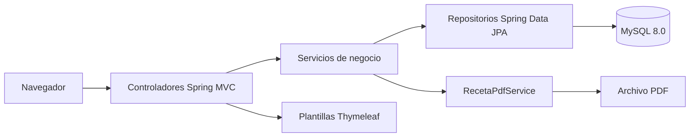
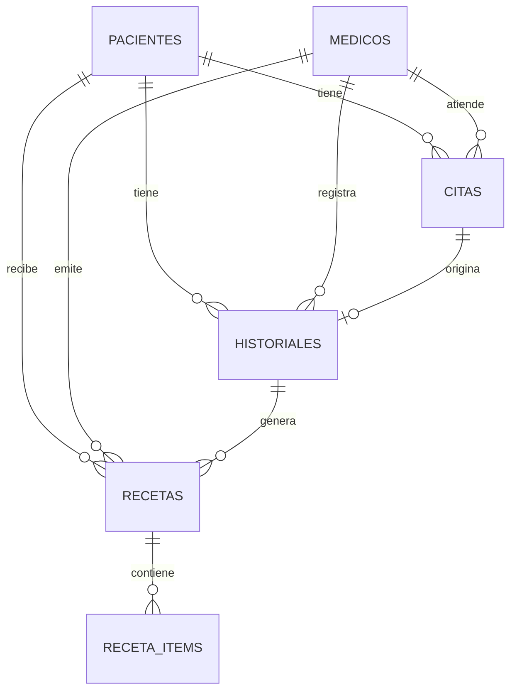

# Documentacion Tecnica

## Sistema de Gestion de Servicios - Clinica San Rafael

---

## 1. Objetivo

El sistema permite administrar los servicios basicos de una clinica desde una aplicacion web:

- Registro y mantenimiento de pacientes.
- Registro y mantenimiento de medicos.
- Programacion, consulta y cancelacion de citas.
- Registro de atenciones y antecedentes en el historial clinico.
- Emision, consulta y anulacion de recetas medicas.
- Descarga de recetas en PDF.

La aplicacion no incluye autenticacion ni control de roles. Esta disenada como un panel administrativo de uso local.

---

## 2. Alcance

### Incluido

- Interfaz web con Thymeleaf.
- Persistencia en MySQL.
- Migraciones automaticas con Flyway.
- Datos de ejemplo precargados.
- Busquedas y filtros basicos.
- Validaciones de negocio.
- Generacion de PDF con OpenPDF.
- Paginas de error personalizadas.

### No incluido

- Login, autenticacion o autorizacion.
- Gestion de usuarios y roles.
- Facturacion o pagos.
- Envio de correos o notificaciones.
- API REST publica.
- Integracion con servicios externos.
- Historias clinicas adjuntas en archivos.

---

## 3. Tecnologias

| Componente | Tecnologia |
| --- | --- |
| Lenguaje | Java 17 |
| Framework principal | Spring Boot 3.5.16 |
| Web | Spring MVC, Tomcat embebido |
| Vistas | Thymeleaf 3.1 |
| Persistencia | Spring Data JPA, Hibernate 6.6 |
| Base de datos | MySQL 8.0 |
| Migraciones | Flyway |
| PDF | OpenPDF 2.4.0 |
| Build | Maven 3.9.16, Maven Wrapper |
| Frontend | HTML5, CSS3, JavaScript vanilla |
| Pruebas manuales | PowerShell, curl, navegador |

La aplicacion fue compilada y ejecutada con OpenJDK 24.0.1, manteniendo compatibilidad de codigo con Java 17.

---

## 4. Arquitectura

La aplicacion sigue una arquitectura MVC por capas.



### Capas

| Capa | Paquete | Responsabilidad |
| --- | --- | --- |
| Dominio | `domain` | Entidades JPA, enumeraciones y propiedades calculadas. |
| Repositorio | `repository` | Consultas y acceso a datos. |
| Servicio | `service` | Reglas de negocio, validaciones y generacion de PDF. |
| Web | `web.controller` | Rutas HTTP, modelos de vista y manejo de errores. |
| Vistas | `resources/templates` | Paginas Thymeleaf. |
| Estaticos | `resources/static` | CSS y JavaScript. |
| Configuracion | `resources/application.properties` | Puerto, datasource, JPA, Flyway y Thymeleaf. |
| Migraciones | `resources/db/migration` | Esquema y datos iniciales. |

### Flujo de una peticion

1. El navegador solicita una ruta, por ejemplo `GET /pacientes`.
2. `PacienteController` recibe la peticion y consulta a `PacienteService`.
3. `PacienteService` aplica la logica y usa `PacienteRepository`.
4. Hibernate ejecuta la consulta en MySQL.
5. El controlador agrega los datos al `Model`.
6. Thymeleaf renderiza la plantilla `pacientes/list.html` dentro del layout comun.
7. El navegador recibe el HTML.

---

## 5. Modelo de datos



### 5.1. `pacientes`

| Campo | Tipo | Restricciones |
| --- | --- | --- |
| `id` | BIGINT | PK, autoincremental |
| `nombres` | VARCHAR(80) | NOT NULL |
| `apellidos` | VARCHAR(80) | NOT NULL |
| `documento` | VARCHAR(20) | NOT NULL, UNIQUE |
| `fecha_nacimiento` | DATE | NOT NULL |
| `sexo` | VARCHAR(20) | NOT NULL (`MASCULINO`, `FEMENINO`, `OTRO`) |
| `telefono` | VARCHAR(20) | Opcional |
| `email` | VARCHAR(120) | Opcional |
| `direccion` | VARCHAR(200) | Opcional |
| `tipo_sangre` | VARCHAR(10) | Opcional |
| `alergias` | TEXT | Opcional |
| `created_at` | DATETIME | NOT NULL |

### 5.2. `medicos`

| Campo | Tipo | Restricciones |
| --- | --- | --- |
| `id` | BIGINT | PK, autoincremental |
| `nombres` | VARCHAR(80) | NOT NULL |
| `apellidos` | VARCHAR(80) | NOT NULL |
| `especialidad` | VARCHAR(80) | NOT NULL |
| `colegiatura` | VARCHAR(30) | NOT NULL, UNIQUE |
| `telefono` | VARCHAR(20) | Opcional |
| `email` | VARCHAR(120) | Opcional |
| `horario` | VARCHAR(120) | Opcional |
| `activo` | TINYINT(1) | NOT NULL, por defecto `1` |
| `created_at` | DATETIME | NOT NULL |

### 5.3. `citas`

| Campo | Tipo | Restricciones |
| --- | --- | --- |
| `id` | BIGINT | PK, autoincremental |
| `paciente_id` | BIGINT | FK a `pacientes`, NOT NULL |
| `medico_id` | BIGINT | FK a `medicos`, NOT NULL |
| `fecha_hora` | DATETIME | NOT NULL |
| `motivo` | VARCHAR(255) | NOT NULL |
| `estado` | VARCHAR(20) | `PROGRAMADA`, `ATENDIDA`, `CANCELADA` |
| `observaciones` | TEXT | Opcional |
| `created_at` | DATETIME | NOT NULL |

Indices relevantes:

- `idx_citas_fecha_hora`
- `idx_citas_estado`
- `idx_citas_medico_fecha`
- `idx_citas_paciente_fecha`

### 5.4. `historiales`

| Campo | Tipo | Restricciones |
| --- | --- | --- |
| `id` | BIGINT | PK, autoincremental |
| `paciente_id` | BIGINT | FK a `pacientes`, NOT NULL |
| `medico_id` | BIGINT | FK a `medicos`, NOT NULL |
| `cita_id` | BIGINT | FK a `citas`, UNIQUE, opcional |
| `fecha_consulta` | DATETIME | NOT NULL |
| `motivo_consulta` | VARCHAR(255) | NOT NULL |
| `diagnostico` | TEXT | NOT NULL |
| `tratamiento` | TEXT | Opcional |
| `notas` | TEXT | Opcional |
| `peso` | DECIMAL(5,2) | Opcional |
| `talla` | DECIMAL(5,2) | Opcional |
| `presion_arterial` | VARCHAR(20) | Opcional |
| `temperatura` | DECIMAL(4,1) | Opcional |
| `frecuencia_cardiaca` | INT | Opcional |
| `created_at` | DATETIME | NOT NULL |

La columna `cita_id` es unica, por lo que una cita solo puede tener un historial asociado.

### 5.5. `recetas`

| Campo | Tipo | Restricciones |
| --- | --- | --- |
| `id` | BIGINT | PK, autoincremental |
| `paciente_id` | BIGINT | FK a `pacientes`, NOT NULL |
| `medico_id` | BIGINT | FK a `medicos`, NOT NULL |
| `historial_id` | BIGINT | FK a `historiales`, NOT NULL |
| `fecha_emision` | DATETIME | NOT NULL |
| `indicaciones_generales` | TEXT | Opcional |
| `estado` | VARCHAR(20) | `EMITIDA`, `ANULADA` |
| `created_at` | DATETIME | NOT NULL |

### 5.6. `receta_items`

| Campo | Tipo | Restricciones |
| --- | --- | --- |
| `id` | BIGINT | PK, autoincremental |
| `receta_id` | BIGINT | FK a `recetas`, NOT NULL, ON DELETE CASCADE |
| `medicamento` | VARCHAR(120) | NOT NULL |
| `presentacion` | VARCHAR(80) | Opcional |
| `dosis` | VARCHAR(80) | Opcional a nivel de base, requerido en la logica de creacion |
| `frecuencia` | VARCHAR(80) | Opcional a nivel de base, requerido en la logica de creacion |
| `duracion` | VARCHAR(60) | Opcional |
| `cantidad` | VARCHAR(40) | Opcional |
| `indicaciones` | VARCHAR(255) | Opcional |

### Relaciones

- Un paciente puede tener muchas citas, historiales y recetas.
- Un medico puede tener muchas citas, historiales y recetas.
- Una cita puede originar como maximo un historial.
- Un historial puede generar recetas.
- Una receta tiene uno o mas items; los items se eliminan en cascada con la receta.

---

## 6. Enumeraciones

### `Sexo`

- `MASCULINO`
- `FEMENINO`
- `OTRO`

### `EstadoCita`

- `PROGRAMADA`
- `ATENDIDA`
- `CANCELADA`

### `EstadoReceta`

- `EMITIDA`
- `ANULADA`

Los enums se almacenan como texto en la base de datos y se muestran con etiquetas en espanol en las vistas.

---

## 7. Reglas de negocio

### Pacientes

- El documento es obligatorio y unico.
- El documento se normaliza eliminando espacios al inicio y al final.
- Al editar, no se permite duplicar el documento de otro paciente.
- No se puede eliminar un paciente con citas, historiales o recetas registradas.

### Medicos

- La colegiatura es obligatoria y unica.
- La colegiatura se normaliza eliminando espacios al inicio y al final.
- Al editar, no se permite duplicar la colegiatura de otro medico.
- No se puede eliminar un medico con citas, historiales o recetas registradas.

### Citas

- La fecha y hora son obligatorias.
- No se puede crear una cita en una fecha u hora pasada.
- No se permite que un medico tenga dos citas en la misma fecha y hora, salvo que la cita existente este cancelada.
- No se permite que un paciente tenga dos citas en la misma fecha y hora, salvo que la cita existente este cancelada.
- Una cita nueva se registra en estado `PROGRAMADA`.
- Una cita `ATENDIDA` no puede volver a otro estado.
- Una cita `CANCELADA` no puede marcarse como `ATENDIDA`.
- La validacion de conflictos compara la fecha y hora exactas.

### Historial clinico

- Se puede crear desde una cita o seleccionando paciente y medico manualmente.
- Si se crea desde una cita:
  - La cita debe existir.
  - La cita no puede estar cancelada.
  - La cita no debe tener ya un historial.
  - Al guardar el historial, la cita pasa a estado `ATENDIDA`.
- El motivo de consulta y el diagnostico son obligatorios.
- Al editar un historial, no se reemplazan las relaciones de paciente, medico y cita.

### Recetas

- Toda receta debe estar asociada a un historial clinico existente.
- El paciente y el medico se toman automaticamente del historial.
- Debe existir al menos un medicamento con nombre.
- Cada medicamento valido debe tener dosis y frecuencia.
- Los items sin nombre de medicamento se ignoran.
- Al crear la receta, el estado inicial es `EMITIDA`.
- Una receta puede anularse desde su detalle y pasa a estado `ANULADA`.
- El PDF se puede generar para recetas emitidas o anuladas; el estado se muestra en la vista de detalle.

### Eliminacion

- Las entidades relacionadas no se eliminan en cascada desde pacientes, medicos, citas o historiales.
- Los items de receta si se eliminan en cascada al eliminar una receta.
- Los intentos de eliminar pacientes o medicos con dependencias se rechazan con un mensaje de negocio.

---

## 8. Repositorios

Los repositorios extienden `JpaRepository`.

### `PacienteRepository`

- `findAllByOrderByApellidosAscNombresAsc()`
- `existsByDocumento(String)`
- `existsByDocumentoAndIdNot(String, Long)`
- `buscar(String q)`: busca por nombres, apellidos o documento.

### `MedicoRepository`

- `findAllByOrderByApellidosAscNombresAsc()`
- `findByActivoTrueOrderByApellidosAscNombresAsc()`
- `existsByColegiatura(String)`
- `existsByColegiaturaAndIdNot(String, Long)`
- `buscar(String q)`: busca por nombres, apellidos, especialidad o colegiatura.

### `CitaRepository`

- `findAllByOrderByFechaHoraDesc()`
- `findByPacienteIdOrderByFechaHoraDesc(Long)`
- `countByEstado(EstadoCita)`
- `countByFechaHoraBetween(LocalDateTime, LocalDateTime)`
- `findTop5ByFechaHoraAfterAndEstadoOrderByFechaHoraAsc(...)`
- `existsByPacienteId(Long)`
- `existsByMedicoId(Long)`
- `buscar(...)`: filtrar por estado, medico y rango de fechas.
- `existeConflictoMedico(...)`
- `existeConflictoPaciente(...)`

### `HistorialMedicoRepository`

- `findAllByOrderByFechaConsultaDesc()`
- `findTop5ByOrderByFechaConsultaDesc()`
- `findByPacienteIdOrderByFechaConsultaDesc(Long)`
- `findByCitaId(Long)`
- `existsByCitaId(Long)`
- `existsByCitaIdAndIdNot(Long, Long)`
- `existsByPacienteId(Long)`
- `existsByMedicoId(Long)`
- `buscar(String q)`: busca por paciente, documento, diagnostico o medico.

### `RecetaRepository`

- `findAllByOrderByFechaEmisionDesc()`
- `findByPacienteIdOrderByFechaEmisionDesc(Long)`
- `findByHistorialId(Long)`
- `countByEstado(EstadoReceta)`
- `existsByPacienteId(Long)`
- `existsByMedicoId(Long)`
- `existsByHistorialId(Long)`
- `buscar(String q)`: busca por paciente, documento o medico.

### Nota sobre propiedades seleccionadas

Los formularios de citas, historiales y recetas usan campos transient para conservar el ID seleccionado en la vista:

- `Cita`: `pacienteSeleccionadoId`, `medicoSeleccionadoId`.
- `HistorialMedico`: `pacienteSeleccionadoId`, `medicoSeleccionadoId`, `citaSeleccionadaId`.
- `Receta`: `historialSeleccionadoId`.

Estos nombres se eligieron deliberadamente para no colisionar con las propiedades anidadas `paciente.id`, `medico.id`, `cita.id` e `historial.id` que utiliza Spring Data JPA en las consultas derivadas.

---

## 9. Servicios

| Servicio | Responsabilidad |
| --- | --- |
| `PacienteService` | Listado, busqueda, alta, edicion, eliminacion y conteo de pacientes. |
| `MedicoService` | Listado, busqueda, alta, edicion, eliminacion y conteo de medicos. |
| `CitaService` | Agenda, conflictos, cambios de estado y conteos de citas. |
| `HistorialService` | Registro y consulta de historiales, actualizacion del estado de la cita. |
| `RecetaService` | Creacion, listado, anulacion y reglas de recetas. |
| `RecetaPdfService` | Generacion del PDF con OpenPDF. |
| `DashboardService` | Indicadores y listados recientes del dashboard. |

---

## 10. Controladores y rutas

### Dashboard

| Metodo | Ruta | Descripcion |
| --- | --- | --- |
| GET | `/` | Dashboard con indicadores y listados recientes. |

### Pacientes

| Metodo | Ruta | Descripcion |
| --- | --- | --- |
| GET | `/pacientes` | Listado y busqueda con parametro `q`. |
| GET | `/pacientes/nuevo` | Formulario de alta. |
| POST | `/pacientes` | Crea un paciente. |
| GET | `/pacientes/{id}` | Detalle del paciente con citas, historiales y recetas. |
| GET | `/pacientes/{id}/editar` | Formulario de edicion. |
| POST | `/pacientes/{id}` | Actualiza un paciente. |
| POST | `/pacientes/{id}/eliminar` | Intenta eliminar un paciente. |

### Medicos

| Metodo | Ruta | Descripcion |
| --- | --- | --- |
| GET | `/medicos` | Listado y busqueda con parametro `q`. |
| GET | `/medicos/nuevo` | Formulario de alta. |
| POST | `/medicos` | Crea un medico. |
| GET | `/medicos/{id}/editar` | Formulario de edicion. |
| POST | `/medicos/{id}` | Actualiza un medico. |
| POST | `/medicos/{id}/eliminar` | Intenta eliminar un medico. |

### Citas

| Metodo | Ruta | Descripcion |
| --- | --- | --- |
| GET | `/citas` | Agenda con filtros `fecha`, `estado` y `medicoId`. |
| GET | `/citas/nueva` | Formulario de alta; acepta `pacienteId` y `medicoId` como preseleccion. |
| POST | `/citas` | Crea una cita. |
| GET | `/citas/{id}` | Detalle de la cita y su historial asociado. |
| GET | `/citas/{id}/editar` | Formulario de edicion. |
| POST | `/citas/{id}` | Actualiza una cita. |
| POST | `/citas/{id}/estado` | Cambia el estado a traves del parametro `estado`. |
| POST | `/citas/{id}/cancelar` | Cancela la cita. |

### Historial clinico

| Metodo | Ruta | Descripcion |
| --- | --- | --- |
| GET | `/historial` | Listado y busqueda con parametro `q`. |
| GET | `/historial/nuevo` | Formulario de alta; acepta `citaId`, `pacienteId` y `medicoId`. |
| POST | `/historial` | Crea un historial. |
| GET | `/historial/{id}` | Detalle del historial. |
| GET | `/historial/{id}/editar` | Formulario de edicion. |
| POST | `/historial/{id}` | Actualiza un historial. |

### Recetas

| Metodo | Ruta | Descripcion |
| --- | --- | --- |
| GET | `/recetas` | Listado y busqueda con parametro `q`. |
| GET | `/recetas/nueva` | Formulario de alta; acepta `historialId`. |
| POST | `/recetas` | Crea una receta con sus items. |
| GET | `/recetas/{id}` | Detalle de la receta. |
| POST | `/recetas/{id}/anular` | Anula la receta. |
| GET | `/recetas/{id}/pdf` | Descarga la receta en PDF. |

### Errores

| Ruta | Descripcion |
| --- | --- |
| `error/404` | Recurso no encontrado. |
| `error/405` | Metodo HTTP no permitido para la ruta. |
| `error/500` | Error interno no controlado. |
| `error` | Pagina de error generica de Spring Boot. |

`GlobalExceptionHandler` captura `ResourceNotFoundException`, `NoResourceFoundException`, `HttpRequestMethodNotSupportedException` y cualquier excepcion no controlada. `GlobalModelAdvice` agrega `currentPath` al modelo para resaltar la seccion activa del menu.

---

## 11. Vistas y frontend

### Layout

El archivo `templates/fragments/layout.html` define:

- Barra lateral con enlaces a todos los modulos.
- Encabezado superior.
- Mensajes flash de exito y error.
- Insercion del contenido de cada pagina.
- Carga de CSS y JavaScript.

Las paginas usan el fragmento:

```html
th:replace="~{fragments/layout :: layout(~{::titulo}, ~{::section})}"
```

### Plantillas por modulo

- `dashboard/index.html`
- `pacientes/list.html`, `pacientes/form.html`, `pacientes/detail.html`
- `medicos/list.html`, `medicos/form.html`
- `citas/list.html`, `citas/form.html`, `citas/detail.html`
- `historial/list.html`, `historial/form.html`, `historial/detail.html`
- `recetas/list.html`, `recetas/form.html`, `recetas/detail.html`
- `error/404.html`, `error/405.html`, `error/500.html`, `error.html`

### JavaScript

`static/js/app.js` implementa:

- Apertura y cierre del menu lateral en pantallas pequenas.
- Confirmacion antes de acciones destructivas.
- Agregado y eliminacion dinamica de filas de medicamentos en el formulario de receta.
- Reindexado de los campos `items[n]` para que Spring MVC reciba correctamente las filas.

### CSS

`static/css/styles.css` contiene estilos para:

- Layout general y barra lateral.
- Tarjetas del dashboard.
- Tablas y listados.
- Formularios y validaciones.
- Badges de estados.
- Paginas de detalle.
- Paginas de error.
- Diseno responsive.

---

## 12. Generacion de PDF

La clase `RecetaPdfService` genera el documento con OpenPDF.

Contenido del PDF:

- Nombre y datos de la clinica.
- Titulo `RECETA MEDICA`.
- Codigo de receta y fecha de emision.
- Datos del paciente: nombre, documento, edad, sexo y alergias.
- Datos del medico: nombre, especialidad, colegiatura y telefono.
- Diagnostico del historial.
- Tabla de medicamentos con presentacion, dosis, frecuencia, duracion, cantidad e indicaciones.
- Indicaciones generales.
- Linea de firma, nombre del medico y colegiatura.
- Pie de pagina con aviso de documento generado electronicamente.

El controlador devuelve el archivo con:

- `Content-Type: application/pdf`
- `Content-Disposition: attachment`
- Nombre de archivo `receta-REC-000001.pdf`

---

## 13. Configuracion

### `application.properties`

```properties
spring.application.name=servicios-pacientes
spring.config.import=optional:file:./config/local.properties

server.port=8080
server.error.whitelabel.enabled=false

spring.datasource.url=jdbc:mysql://127.0.0.1:3307/clinica_db?useSSL=false&allowPublicKeyRetrieval=true&serverTimezone=America/Lima&characterEncoding=UTF-8
spring.datasource.driver-class-name=com.mysql.cj.jdbc.Driver

spring.jpa.hibernate.ddl-auto=none
spring.jpa.open-in-view=false
spring.jpa.show-sql=false

spring.flyway.enabled=true
spring.flyway.locations=classpath:db/migration

spring.thymeleaf.cache=false
spring.web.resources.cache.period=0
```

### Credenciales locales

Las credenciales no se versionan. La aplicacion y los scripts las leen desde `config/local.properties`, un archivo ignorado por Git:

```properties
spring.datasource.username=clinica_user
spring.datasource.password=...
db.root.password=...
```

| Elemento | Valor |
| --- | --- |
| Host | `127.0.0.1` |
| Puerto MySQL | `3307` |
| Base de datos | `clinica_db` |
| Usuario de aplicacion | `clinica_user` |
| Usuario root local | `root` |
| Credenciales | `config/local.properties` |

Si el archivo no existe y la base local es nueva, `start-all.ps1` lo genera con contrasenas aleatorias. Para configurarlas manualmente, copie `config/local.properties.example` como `config/local.properties` y complete los valores. En produccion se debe usar un gestor de secretos.

---

## 14. Scripts de operacion

### `mysql-init.ps1`

Responsabilidades:

1. Leer `config/local.properties`; si no existe y la base local es nueva, generarlo con credenciales aleatorias.
2. Verificar que MySQL exista en `C:\Program Files\MySQL\MySQL Server 8.0`.
3. Crear `mysql-data/` y `mysql-logs/`.
4. Inicializar la instancia si no existe el directorio `mysql-data/mysql`.
5. Arrancar MySQL en el puerto `3307` si no esta activo.
6. Detectar si root ya tiene password.
7. Crear la base `clinica_db`, el usuario de aplicacion y otorgar privilegios.
8. Validar el acceso con el usuario de aplicacion.

El directorio de datos se llama `mysql-data` sin punto inicial. En MySQL 8.0.43 sobre Windows se detecto un fallo al usar un directorio como `.mysql-data`, relacionado con la creacion de tablespaces UNDO. Por eso se utiliza `mysql-data`.

### `mysql-start.ps1`

Ejecuta `mysql-init.ps1` para garantizar que MySQL este inicializado y disponible.

### `mysql-stop.ps1`

Detiene MySQL mediante `mysqladmin shutdown`. Si no responde, intenta terminar el proceso que escucha en el puerto `3307`.

### `start-all.ps1`

1. Detecta `JAVA_HOME` o busca un JDK en ubicaciones conocidas.
2. Verifica o genera `config/local.properties`.
3. Ejecuta `mysql-init.ps1`.
4. Verifica si el puerto `8080` ya esta ocupado.
5. Busca el jar compilado; si no existe, ejecuta Maven Wrapper.
6. Arranca la aplicacion en segundo plano.
7. Espera hasta 90 segundos a que `http://localhost:8080/` responda con estado 200.

### `stop-all.ps1`

Detiene la aplicacion que escucha en el puerto `8080` y luego ejecuta `mysql-stop.ps1`.

### Archivos `.cmd`

- `start-all.cmd`: ejecuta `start-all.ps1` con PowerShell.
- `stop-all.cmd`: ejecuta `stop-all.ps1` con PowerShell.

### Logs

| Archivo | Contenido |
| --- | --- |
| `.logs/app.out.log` | Salida estandar de Spring Boot. |
| `.logs/app.err.log` | Errores de Spring Boot. |
| `mysql-logs/mysql.err.log` | Log del servidor MySQL. |
| `mysql-logs/mysql-init.*.log` | Inicializacion de MySQL. |
| `mysql-logs/mysql-setup.*.log` | Configuracion de base y usuario. |

---

## 15. Migraciones Flyway

### `V1__schema.sql`

Crea las tablas:

- `pacientes`
- `medicos`
- `citas`
- `historiales`
- `recetas`
- `receta_items`

Incluye indices, claves foraneas y la regla `ON DELETE CASCADE` para los items de receta.

### `V2__seed_data.sql`

Carga datos de ejemplo:

- 6 pacientes.
- 5 medicos.
- 12 citas.
- 4 historiales.
- 4 recetas.
- 8 items de receta.

Las tablas principales se reinician con `AUTO_INCREMENT = 100` para dejar espacio a los datos de ejemplo.

Las migraciones se ejecutan automaticamente al iniciar la aplicacion. No se debe modificar una migracion ya aplicada en una base existente; para cambios posteriores se debe crear una nueva version, por ejemplo `V3__...sql`.

---

## 16. Manejo de errores

- `ResourceNotFoundException`: se lanza cuando no existe un paciente, medico, cita, historial o receta solicitada. Devuelve HTTP 404.
- `BusinessException`: representa una regla de negocio incumplida. Se captura en los controladores y se muestra como error de formulario o mensaje flash.
- `NoResourceFoundException`: ruta o recurso estatico inexistente. Devuelve HTTP 404.
- `HttpRequestMethodNotSupportedException`: metodo HTTP no permitido. Devuelve HTTP 405.
- Cualquier otra excepcion no controlada devuelve HTTP 500 y se registra en el log.

Las vistas de error no usan el layout principal para evitar dependencias adicionales durante el fallo.

---

## 17. Verificacion realizada

Se realizaron pruebas manuales sobre la instancia local:

- Compilacion exitosa con `mvn -DskipTests package`.
- Inicio correcto de MySQL en el puerto `3307`.
- Ejecucion de Flyway con las migraciones `V1` y `V2`.
- Inicio de Spring Boot en el puerto `8080`.
- Respuesta HTTP 200 en dashboard, listados y formularios.
- Creacion de paciente, medico, cita, historial y receta mediante peticiones POST.
- Edicion de paciente, medico, cita e historial.
- Anulacion de receta.
- Descarga de PDF valido con cabecera `%PDF-1.5`.
- Respuestas HTTP 404 y 405 con paginas personalizadas.
- Detencion y arranque integral mediante `stop-all` y `start-all`.

No se incluyen pruebas unitarias automatizadas en el repositorio. La dependencia `spring-boot-starter-test` esta disponible para incorporarlas.

---

## 18. Solucion de problemas

### MySQL no arranca

Revise `mysql-logs/mysql.err.log`. Verifique que el puerto `3307` este libre y que el directorio `mysql-data` no este bloqueado por otro proceso.

### Error de tablespace UNDO

Si aparece un mensaje similar a:

```text
Can't create UNDO tablespace innodb_undo_001 since '.\undo_001' already exists
```

verifique que el directorio de datos no comience con punto. El proyecto usa `mysql-data` por este motivo.

### La aplicacion no responde

Revise `.logs/app.out.log` y `.logs/app.err.log`. Si el puerto `8080` esta ocupado, detenga el proceso que lo utiliza o cambie `server.port`.

### Java incorrecto

El comando `java` del sistema puede apuntar a Java 8. Use `JAVA_HOME` con un JDK 17 o superior o ejecute `start-all.ps1`, que busca automaticamente un JDK disponible.

### Credenciales de root

La primera ejecucion inicializa root sin password y luego establece la contrasena indicada en `config/local.properties`. Si la contrasena fue cambiada manualmente, actualice `db.root.password` en ese archivo o restablezca la instancia local. Si ya existe `mysql-data/` y falta `config/local.properties`, creelo a partir de `config/local.properties.example` con las credenciales actuales.

### Reiniciar la base local

Detenga MySQL y elimine el directorio `mysql-data/` solo si acepta perder los datos locales. En la siguiente ejecucion se volvera a inicializar la instancia y Flyway recreara el esquema y los datos de ejemplo.

---

## 19. Consideraciones para produccion

Antes de usar el sistema en un entorno real:

- Implementar autenticacion y autorizacion.
- Mantener las credenciales fuera del repositorio y usar un gestor de secretos en produccion.
- Cambiar las passwords de MySQL.
- Activar HTTPS.
- Restringir el acceso a la red interna o a traves de VPN.
- Configurar respaldos automaticos de MySQL.
- Activar un perfil de Spring especifico para produccion.
- Deshabilitar `spring.thymeleaf.cache=false` y cachear recursos estaticos.
- Agregar pruebas automatizadas de integracion y de reglas de negocio.
- Revisar el tratamiento de datos personales y las normas de proteccion de datos aplicables.

---

## 20. Mantenimiento y extension

Para agregar una nueva funcionalidad se recomienda:

1. Crear o modificar la entidad en `domain`.
2. Agregar el repositorio correspondiente.
3. Implementar la logica en un servicio.
4. Crear el controlador y las plantillas.
5. Agregar una nueva migracion Flyway si cambia el esquema.
6. Probar el flujo completo con datos de ejemplo.

Para nuevos cambios de base de datos, nunca edite `V1` o `V2` en una base ya migrada; cree una migracion `V3__descripcion.sql`.
